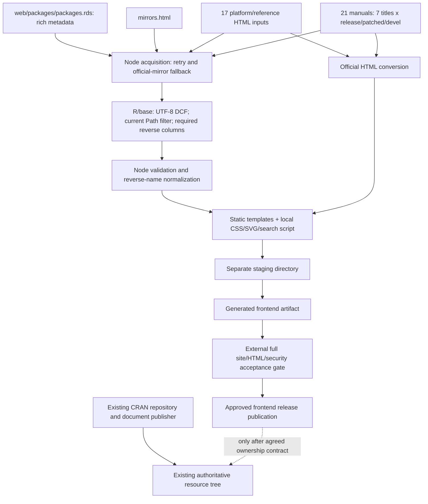

# CRAN: Infrastructure Compatibility & Adoption Feasibility

Investigation date: **2026-10-29, Europe/Riga**. Subject: current `r_site` after reverse dependency implementation. This is an engineering assessment and local experiment, not CRAN approval or a plan to change production without the infrastructure owners.

## Conclusion

**CRAN could technically use this generator as an additional static frontend source while retaining repositories and mirrors. However, the current `r_site` is not a ready replacement for published CRAN, and deployment is not simply copying `dist` over the server.**

The evidence supports **C → limited B**: first, an experimental frontend at the root of a separate origin, retaining existing CRAN as the authoritative source for downloads and documents. A partial HTML overlay could follow an accepted ownership contract, full URL/resource inventory, and agreed publication hook. Strategy A, replacing the tree with `dist` alone, is unacceptable: repository files and many documents are absent.

Static output reduces runtime complexity but does not resolve path ownership, publication consistency, cache/mirror propagation, material availability, code rights, or long-term support. CRAN's native publisher need not be replaced with Node; an integration stage and an organizational owner are still necessary.

## 1. Evidence-based model of official CRAN

### Confirmed by public materials

The CRAN Mirror HOWTO describes the master at WU Wien and the `cran.r-project.org::CRAN` rsync module, recursive tree synchronization with deletion of removed files, recommends rsync/SSH, and suggests updates every 1–2 days and no more than twice daily. The tree contains symlinks; permissions and their preservation are the operator's responsibility. HTTP serving includes index files, `.shtml`, and directory listings under `/src` and `/bin`; SSI for mirror branding is optional. The document provides Apache and Nginx configuration examples. This is **not** evidence that every CRAN node uses one server or operating system. [Official Mirror HOWTO](https://cran.r-project.org/mirror-howto.html).

CRAN-style repositories have a `src/contrib` source branch, binary branches under `bin/` with platform/build/R-version components, and metadata indexes `PACKAGES`, optionally `PACKAGES.gz`/`PACKAGES.rds`. Source/binary artifacts and repository indexes form an R-client contract distinct from the HTML catalog. The `Path` field supports subdirectories. [R Installation and Administration, repository layout](https://cran.r-project.org/doc/manuals/r-release/R-admin.html#Setting-up-a-package-repository).

Official R provides `tools::write_PACKAGES` to extract metadata from `DESCRIPTION` and write three index forms. The existence of this function does not establish CRAN's current scheduler or exact command. [write_PACKAGES documentation](https://stat.ethz.ch/R-manual/R-devel/library/tools/html/writePACKAGES.html).

The short package page URL `/package=PKG` is documented; `/package=PKG&version=VER` refers to **sources for a specific version**, not selection of an HTML page. [Official package index page on an R Project-hosted mirror](https://stat.ethz.ch/CRAN/web/packages/). Public R source also defines canonical/check URL helpers, but is not a complete publisher implementation. [R tools source](https://svn.r-project.org/R/trunk/src/library/tools/R/CRANtools.R).

R's tools for generating manuals/help and converting Rd to HTML are publicly documented. `Rd2HTML` and `pkg2HTML` operate on help pages; their existence does not prove exactly how the master builds package landing pages or publishes the entire website. [Rd converters](https://stat.ethz.ch/R-manual/R-devel/library/tools/html/Rd2HTML.html), [R manual building](https://cran.r-project.org/doc/manuals/r-release/R-admin.html#Making-the-manuals).

### Observed through ordinary HTTP requests

Of 28 URLs in the HEAD series, 27 returned 200 or 303 (including a deliberately nonexistent version discussed below); `/assets/site.css` on the master returned 404. Responses/headers/Location are retained in `http-audit.json`, but one endpoint's headers do not describe the whole infrastructure. For example, `/package=termr` returned 303 to the long HTML path; the current version redirected to `/src/contrib/termr_1.0.1.tar.gz`; an archived ggplot2 version redirected to `Archive/ggplot2/...`.

For the deliberately missing version `termr 0.0.0`, a 303 to `/web/packages/termr&version=0.0.0/index.html` was observed, followed by 404. This observation must not be replaced with assumptions about the internal resolver. The local model below returns a direct 404 for that version: the terminal error agrees, the redirect chain does not. The operator must approve the exact required behavior.

The saved public corpus confirms archives, package PDFs, checks, Task Views, README/NEWS, and vignettes at ordinary file URLs. It does not establish their update order relative to source/binary metadata.

### Unknown

Unknown details include private publishing scripts and languages, job topology/locking, transactional release ID source, cron/queue cadence, internal staging and rollback, storage/CDN topology, complete server rewrite configuration, rsync module filters, all mirrors' cache policies, and ownership rules between generators. It is not established that CRAN uses GitHub Actions, Nginx, Node, a particular database, a particular operating system, or this project's atomic publication pattern.

## 2. What r_site actually does

### Components and dependencies

| Purpose | Required |
|---|---|
| Generation | Node.js standard modules; base R for `readRDS`/`write.dcf`; working UTF-8 locale; network and filesystem |
| Serving built files | Ordinary static web server; MIME/index/404 handling; rewrite/file-existence rules for short aliases |
| Browser search | Optional `search.js`, one `[Package, Title]` JSON; name-only matching |
| Ordinary navigation, package/reverse pages | HTML, CSS, SVG; works without JavaScript |
| CI/release validation | Node tests/checker, R regression; Python for the separate HTML checker |
| Laboratory stand | Existing Playwright, Nginx, rsync installations; not site runtime dependencies |

Building does not require `npm install` or application npm packages. This does not eliminate operational dependencies: supported Node/R versions, locale, and upstream access are needed. `package.json` allows Node >=20, CI uses Node 22 and R 4.5.2, and this experiment used Windows Node 26.11.1 / R 4.5.2. CONTRIBUTING's documented “R >=4.0” is broader than the tested contract: the R regression fixture uses the native pipe, requiring R >=4.1. An unambiguous support matrix is needed before adoption.

### Complete input/output flow

Input code: `scripts/fetch-cran-data.mjs`, `scripts/build.mjs`, `scripts/export-cran-data.R`; templates/converter: `src/`. A normal build acquires 40 resources: rich RDS + mirrors + 17 HTML files + 21 manuals, with possible retries on fallback. `/web/packages/packages.rds` is **not** a replacement for `/src/contrib/PACKAGES.rds` or binary repository indexes. The generator does not produce those indexes at all.

The 17 HTML inputs include Windows base/contrib/Rtools/FAQ, macOS root/contrib/tools/FAQ, Debian/Ubuntu/Fedora, manuals index, FAQ, mirror HOWTO, policies, team, and source base listing. `macos` selects installers; the other 16 become converted pages. Manuals are R-FAQ, R-intro, R-data, R-admin, R-exts, R-lang, and R-ints for three versions. Resources are acquired sequentially, not in one upstream transaction.

The isolated build produced **33606 HTML files**: 25585 package indexes, 7949 reverse pages, 26 letter pages, and 46 other HTML files. The latter comprise 21 manuals, 16 converted official pages, home, three platform pages, catalog, catalog redirect, mirrors, and two source landing pages. Five additional files: CSS, search script, search JSON, `Rlogo.svg`, `_headers`.

It does not generate source/binary archives, repository `PACKAGES*`, previous package versions, package PDFs/refman, README/NEWS/vignette inventories, checks, or Task Views. The actual distribution/repository tree must retain separate ownership of these objects. The complete output path inventory is in `inventory.json`, not merely the deployment guide's examples.

### Publication and reproducibility: important limitations

1. Known schema errors, missing reverse columns, and invalid names fail the build. A count of >=1000 packages is a sanity threshold, not evidence that an authoritative snapshot is complete.
2. Main/reverse pages share one RDS. However, RDS, platform listings, and manuals are acquired at different times and may come from different official mirrors. There is no shared publisher transaction ID.
3. `CRAN_BUILD_AUDIT_DIR` saves RDS/DCF/hash. It does not automatically capture all 40 original bodies/headers or the exact toolchain; a live build is not a byte-reproducible replay protocol.
4. `buildSite` first renames old `dist` to backup, then staging to `dist`. Between these operations, `dist` is absent; this is **not** an atomic pointer exchange for live HTTP. Failure recovery exists, but a successful build deletes the backup.
5. Full `check:site` runs separately **after** the build. Do not run the stock build directly in a live document root and assume the complete release was validated before publication. CI checks the artifact but does not implement CRAN deployment/rollback.

Accordingly, the experiment below tests an external immutable-release publisher; it does not claim that the project already supplies this production publication mechanism.

## 3. Strategy comparison

| Criterion | A. Replace the entire tree | B. Partial static overlay | C. Separate frontend |
|---|---|---|---|
| Preserve native repositories | `dist` alone loses them; full merged replacement must include the entire native tree | Possible if repository/document payload writes are prohibited | Native tree unchanged |
| Infrastructure change | Major cutover/storage/routing; large blast radius | New renderer + publication hook + ownership manifest; existing server can remain | Separate static origin/build job/DNS/TLS; master/mirrors need not change |
| Build-time | Node/R + full native publisher for a merged-tree approach | Node/R on builder; native publisher continues | Node/R on experimental builder only |
| Runtime | Static serving insufficient without all content/aliases | Static files and approved existing-server rules; no Node/R on web/mirrors | Static serving; canonical resource links use existing CRAN |
| Mirrors | Replacing the tree risks deleting repository objects | Ordinary rsync can transfer files, but base-path/assets/mtime/ownership still need resolution | Repository mirrors unaffected; frontend does not itself become a CRAN mirror |
| Publication | Fully coordinated replacement, likely an expensive snapshot | Ownership-aware overlay after native publishing; never `--delete` all CRAN using `dist` as source | Independent immutable artifact + validation + pointer |
| Rollback | Restoring a huge native tree may restore stale package indexes/payloads | Frontend-only rollback still needs coordination with the changed native repository | Simple frontend rollback; native CRAN remains current |
| Link risks | Many demonstrated 404s with `dist` only | Directory listings, short links, removed packages, asset namespaces, mirror affinity | Incomplete workflows; absolute CRAN resources are appropriate, but canonical/SEO/freshness policy needed |
| Maintenance | Maximum responsibility for the whole service | Coordinate two publishers and maintain manifest/compatibility tests | New supported UI service, with less risk to R installations |
| CRAN involvement | Full topology/storage/publication authority | Ownership boundary, hook, URL mapping, release/cache/mirror contract | Name/positioning approval, data/freshness policy, owner/support |

Neither A nor B requires users or mirrors to install Node. A runtime-independent static payload is a real advantage of B, but does not establish organizational readiness. C is recommended first because it presents less risk to CRAN's obligations to R clients and independent mirror operators, not merely because development is easier.

## 4. URL compatibility audit

HEAD does not download payloads or prove the entire workflow. “Public” below means ordinary HTTP checks on the audit date; “local” means the limited snapshot and specific prototype. Raw responses are retained.

| Class / example | Public | Current r_site / local finding |
|---|---|---|
| `/` | 200 | New HTML works without JS; original frameset/optional mirror branding changes |
| `/bin/windows/`, `/bin/macosx/`, `/bin/linux/` | 200 | Routes exist; UI overlay, not binary repositories |
| `/web/packages/` | 200 | New catalog works; legacy all-package table route now meta-refreshes to catalog, unlike its former table content |
| `/web/packages/termr/index.html` | 200 | Long route retained; metadata update/rollback tested on a real changed package page |
| `/package=termr` | 303 → long HTML | Stock deploy configuration lacks resolver; only a separate test rule added to stand |
| `/package=termr&version=1.0.1` | 303 → source tarball | Local existence-checked 303 → unchanged native source artifact |
| Archived version, ggplot2 4.0.2 | 303 → Archive path | Local archive resolver tested using a genuine saved uuid 1.2-1 artifact |
| Unknown package/version | Terminal 404; extra redirect observed for version case | Stand returns direct 404; exact redirect equivalence not claimed |
| `/src/contrib/PACKAGES{,.gz,.rds}` | 200 | Not generated; actual `.rds` retained and read by a modern R client through overlay/mirror |
| `/src/contrib/termr_1.0.1.tar.gz` | 200 | Payload SHA-256 preserved; version resolver does not substitute HTML |
| `/bin/windows/contrib/4.6/PACKAGES.rds`, `termr_1.0.1.zip` | 200 | Preserved; binary Range request returned 206, 16 bytes |
| `/bin/macosx/sonoma-arm64/contrib/4.6/PACKAGES.rds` | 200 | Preserved and byte-checked; macOS installation workflow not performed |
| `/manuals.html`, `/doc/manuals/r-release/R-intro.html` | 200 | Converted/generated; selected URLs preserved, full anchor/format parity not proved by this stand |
| `/web/checks/check_results_termr.html` | 200 | Native file not overwritten; current pages contain direct master link |
| `/src/contrib/Archive/ggplot2/` | 200 | Archives remain native; one genuine historical payload retained |
| `/web/views/` | 200 | Native index retained; complete topic/resource closure not copied |
| Vignette, README, NEWS, package PDF | 200 | Saved files unchanged; inventory UI remains incomplete |
| `/src/contrib/` and some `/bin/` indexes | 200 | **Intercepted by new index.html**; raw child objects remain, directory discovery changes |
| `/assets/site.css`, `Rlogo.svg` | First returned 404 on master; second already existed in corpus | New namespace needs approval; Rlogo is an intentional existing-file collision |
| Mirror under `/CRAN/` | Subdirectory deployment appears in public mirror examples | **Failed locally:** root-relative CSS `/assets/site.css` returned 404; navigation also lacks base-path support |

Critical machine paths are determined by the HTTP repository protocol and filenames in `PACKAGES*`, not landing-page hyperlinks. Even correct path names do not permit replacing an index payload with HTML and status 200: that breaks clients. An unknown local repository object returned a real 404; there is no SPA fallback.

A separate mirror-affinity problem: source/PDF/check/index/archive hyperlinks in templates use `CRAN_BASE` instead of automatically using the current mirror origin. On a mirrored overlay, bytes are available locally, but users are often sent back to the master. This is expected for root-hosted C; B needs a relative/public resource base policy. Long canonical paths and short canonical identifiers must not be confused with the query-string search form.

## 5. Local adoption prototype

### Composition and isolation

- Based on 16 previously retained official files and 14 additional bounded GETs: repository RDS, one source tarball, one old tarball, one Windows ZIP, a package PDF, and several HTML/material files. Total: **30 original files, 15900478 B**. No package code was installed or executed.
- Generated R1 is the earlier successful production `dist`; R2 is a **new isolated full build** in `audits/adoption/.cache/generated`. It uses unchanged production build functions with another `outDir`. Production frontend unchanged.
- Originals are retained separately and never edited. Physical merged releases on ext4 contain the original corpus + manifest-reviewed generated files. `_headers` is excluded from the Nginx view. Overlay policy prohibits source/binary/index/PDF/check/view/material objects; HTML index ownership is reviewed separately.
- Stand: separate Nginx at **127.0.0.1:8088**; local rsync mirror **8089**; subdirectory negative control **8091**; `dist`-only negative control **8092**. Neither main Nginx nor port/config 8080 changed.
- Publication uses retained `releases/r1`, `releases/r2`, and a `current` symlink replaced through one native filesystem rename. This is an engineering model, **not CRAN configuration**. No public infrastructure was created.

Archived inputs and results: [audits/adoption/2026-10-29/](audits/adoption/2026-10-29/), including `official-snapshot.tar.gz`, inventory, server configuration, request evidence, and resource monitoring.

### Results

| Check | Result / evidence limit |
|---|---|
| Preserved originals | All 30 original hashes identical before/after; 21 nonowned overlay resources byte-checked over HTTP |
| Ownership collisions | **9 intentionally changed file paths** in the limited corpus: home, selected indexes/manuals/HOWTO/package page, and Rlogo. Not “no conflicts”; inventory retained |
| Protected data injection | The same policy function rejects adding `src/contrib/PACKAGES.rds` to the overlay manifest; actual file unchanged |
| Index priority | New `index.html` takes precedence over native listing; `/src/contrib/` no longer displays the tarball filename although the file remains accessible |
| Canonical routing | Long HTML, short current page, current source version, and archived source version work in the test configuration |
| 404 | Unknown paths/package/version return 404, not homepage HTML |
| Modern R client | Actual R 4.5.2 `available.packages()` read the local source index on baseline, overlay, and updated mirror; termr 1.0.1 found |
| Index row counts | With filters disabled, the R client saw 25600 rows; not the number of unscoped current rich web RDS records (25585). Formats/purposes differ |
| Binary transfer | Genuine Windows ZIP preserved; Range bytes 0–15 returned 206 with correct length |
| Symlink | Relative link fixture survived and worked after local rsync; controlled fixture, not replication of all master links |
| Metadata update | Real `frictionless` page changed from R1 to R2 according to precomputed SHA-256; no invented test metadata |
| Pointer transition | 30 sequential loopback probes around the switch returned only 200; operation wall time including WSL launch ~143 ms. Not formal zero-downtime/cache transaction proof |
| Mirror update/delete | `rsync --delete` updated HTML and removed a labeled local retired-page fixture; inside the stand only |
| Rollback | Pointer and mirror returned to R1; old HTML hash restored; native corpus unchanged |
| No JavaScript | Alphabet → ggplot2 → full reverse HTML works; 26 letters, more than 8000 list entries |
| Prefix negative | `/CRAN/...` document returns 200, its root-relative CSS 404. Base-path portability not provided |
| Replacement negative | `dist`-only server returned 404 for repository index and package PDF |

The 18 recorded checks include positive and expected negative controls. The stand does not prove identical redirect chains, preservation of all Linux/macOS/legacy-R installation workflows, complete documentation anchors, public-mirror propagation, or atomicity relative to a concurrent native CRAN publisher.

The native repository was frozen during the experiment. In an actual rollback, HTML may be older than the updated repository: an old `/src/contrib/pkg_old.tar.gz` may already have moved into Archive. Version-aware download URLs or another approved consistency mechanism are needed. Successful pointer rollback does not automatically solve this.

File-wise preparation through `/mnt/c` was slow and was replaced with archive transfer + native extraction. Initial incomplete preparation/Location assertions were corrected in the harness; pilot/note retained. These were not classified as CRAN defects. Checks passed after correction of the prepared stand.

## 6. Operating cost

### New measurement without production changes

| Metric | Result |
|---|---:|
| Full isolated build | **238.4 s** |
| Acquisition + R export + snapshot capture | 194.9 s |
| Generation + local artifact publish | **43.5 s** |
| Full unchanged checker on isolated output | **22.7 s**, passed |
| Node renderer CPU (self) | 39.1 CPU s |
| Build process tree CPU, last sampled cumulative value per PID | **At least ~206.6 CPU s** |
| Sampled peak summed working sets | **588.0 MiB** |
| Individual peak working set | R ~522.0 MiB; renderer Node ~456.1 MiB |
| HTML / all files | **33606 / 33611** |
| Generated artifact logical size | **218540640 B (~208.4 MiB)** |

Sampling through Win32_Process/Get-Process ran at roughly 500 ms intervals plus query overhead. Short peaks and CPU after the last child sample may be missed; working sets may double-count shared pages. Individual peaks cannot be summed as concurrent RAM. Measurements concern this Windows/WSL machine, not production Linux or global CRAN CPU utilization. The build mostly used about one core; expressing this as a “percentage of all CPUs” would be misleading.

The preceding reverse build took 248.5 s, generation/publication 62.1 s, and checking 62.3 s. The newer isolated output was initially empty, whereas the earlier run also replaced/deleted the old release; snapshots/cache/measurement contexts differ. No speedup is claimed. For a pilot builder, a budget around 1–2 GiB RAM beyond the OS and several minutes of one CPU per release is a reasonable starting estimate, not a guaranteed minimum. Repeating measurements on the agreed CRAN host under quotas is mandatory.

### Storage and atomic releases

The runtime artifact is ~218.5 MB logically. The previous Windows measurement found ~283.1 MB file-data allocation excluding directory/MFT overhead. On the ext4 stand, the complete frontend-only tree occupied ~388.6 MB according to `du`, including directories/block slack; these metrics are not equivalent.

Without deduplication/COW, two frontend releases require ~437.1 MB logical storage; current + rollback + next staging require ~655.6 MB, plus metadata/slack, RDS/DCF (~56 MB per retained snapshot), temporary downloaded inputs, and toolchain. This is **frontend-only**, not a complete CRAN copy. The historical HOWTO cited 410 GB for all CRAN on 2024-02-22; current native-tree size was not measured here. Cloning that tree per UI release, as in the small stand, cannot be proposed without a separate storage design. B requires an existing snapshot/export mechanism or safe owned overlay layer; source/native-tree copies must not become a hidden project cost.

In the actual stand, two merged releases occupied ~799 MB and the synchronized mirror ~399.7 MB. These are experimental artifacts using a limited original corpus, not an estimate of full CRAN size. Hardlink-based releases require demonstrated immutability: writing a shared inode can corrupt the rollback copy.

### Publication and synchronization: observed overhead

Only **6 generated files** differ in bytes between R1/R2, and total logical size differs by 348 B. However, the generator rewrites all HTML and search JSON, changing mtimes. Local `rsync -a --delete --stats` transferred **33607 regular files / 218504196 B literal data**, ~221.6 MB sent, in ~12.9 s; initial mirror sync took ~15.0 s.

This is a local transfer with default whole-file behavior and no `-z`, **not** measured public-mirror bandwidth: remote rsync delta/compression may greatly reduce wire bytes. The substantial file-list/mtime workload is real, however. Content-aware publication retaining unchanged files' mtimes or a justified checksum policy is needed; a small diff alone cannot justify promises of inexpensive incremental publishing. Comparison with CRAN's current publisher requires its job details.

Mirror polling frequency does not determine native publication frequency or required UI freshness. Agreed SLOs and a publisher hook are needed. Infrequent frontend refresh increases stale source-link risk; frequent full rewrites create unnecessary sync/cache work. HTML-only rollback does not roll back package publication or external mirrors.

### Node as an organizational barrier

Technically, Node is needed only on the builder, not mirrors or web servers. Organizationally, it adds a supported toolchain, expertise, and patch responsibility, which CRAN may decline. “No npm dependencies” does not remove responsibility for Node/R and the generator.

Alternatives without immediate rewriting: a separate CI/builder delivering verified immutable artifacts; a pinned Node/R container on an approved executor; an isolated frontend build service with an assigned owner whose output is checked before import. The native publisher can receive finished files without Node on the master. Provenance, review, signing/transfer policy, and rollback are needed; containers alone do not establish trust.

Porting the template renderer to R or an existing approved tool remains a possible future decision, but is neither implemented nor estimated and must not justify “immediate migration.” Retaining input/output contracts and tests allows such a migration later.

## 7. Risk table and required changes

| Risk | Evidence / status | Severity and change required before B |
|---|---|---|
| Repository deletion through `dist --delete` deployment | A negative control: indexes/PDF 404 | P0: separate ownership manifest, protected paths; never sync-delete full CRAN from a frontend-only source |
| Two writers for one HTML file | Project generates native-like paths; private publisher contract unknown | P0: designated ownership/hook, release coordination, complete conflict inventory |
| Directory listings replaced | Local `/src/contrib/` checked | P0/P1 depending on workflow: retain native listings or approve equivalent navigation |
| Short/version/base-prefix URLs | Resolver absent from stock deploy; prefix test failed | P0: approved server rules and base-path/resource-base contract; version routes must not lead to current HTML |
| Stale resources/rollback | Native repository may change independently of UI | P0: snapshot/freshness policy, archive-aware source links, rollback compatibility window |
| Partial parity | Materials/binaries/Task Views/citation inventories incomplete | P0 for full replacement; gate for chosen pilot scope |
| SSI/mirror branding | Public optional feature; not implemented by r_site | P1: preserve approved host attribution/customization |
| Master-bound hyperlinks on mirrors | Hard-coded CRAN_BASE | P1: mirror-local link policy or explicitly limit scope to C |
| Asset namespace/cache versioning | `Rlogo.svg` collision; unversioned CSS/JS and different cache TTLs | P1: reserved namespace, versioned assets/retention, or backwards-compatibility contract |
| Full rewrite/rsync overhead | 33607 transferred files despite only 6 byte-changed files | P1: content-aware mtime handling, remote sync measurement |
| Current publication semantics | Rename gap, backup removal, validation after build | P0 live deploy: offline artifact gate + atomic pointer + retained last-known-good |
| HTML import security | Regex converter, not a strict HTML allowlist; unquoted attributes/object/embed incompletely covered | P0/P1 security review, origin trust boundary, CSP/headers, adversarial tests; no CRAN exploit claimed |
| Supply chain and reproducibility | Live fetch/fallback, limited archives, unpinned runner/actions versions | P1: pinned toolchain/actions, complete input manifest, release provenance, schema-change procedure |
| Rights/support | No root/tracked project LICENSE found; owner/support commitment unspecified | Before adoption: confirm frontend/asset rights and support ownership; no legal conclusion offered |

None of these production changes was made during this investigation. The prototype policy demonstrates a safe limited merge, not a finished universal publishing framework.

A minimal adapter to the native pipeline does not require rewriting the renderer:
`buildSite({records, mirrors, pages, outDir})` already accepts prepared inputs.
A supported offline/local-input mode must read an approved
versioned export from the existing publisher instead of reconstructing a live site through
uncoordinated HTTP reads. Rich web RDS cannot be replaced with ordinary repository PACKAGES.rds:
the required fields differ. This adapter is not yet a finished operator
interface. Separate the builder from privileged publishing and give it only
approved public inputs, not private submissions.

## 8. Objective acceptance checklist

Statuses: PASS — verified within the stated limited scope; OPEN — required decision/check; FAIL — current code/config does not comply without changes. “OPEN” must not automatically be treated as PASS.

| Area | Criterion | Current status |
|---|---|---|
| Functional completeness | Maintainer-approved page/resource matrix, including exceptions, archived/removed packages, binary variants | OPEN; previous parity audit records gaps |
| URL compatibility | Long paths, short/current/archive aliases, unknown versions, 404, trailing slash/query/encoded paths, all promised anchors | PASS subset; stock aliases and prefix portability FAIL |
| Mirror compatibility | Full tree inventory, protected data hashes, symlinks/permissions, root and subdirectory mirrors, no master-affinity regression | PASS limited resources/symlink; prefix FAIL; full network OPEN |
| R clients | Source/binary `PACKAGES*`, redirects/ranges/404 on supported R/OS, install/update behavior | PASS modern source-index read + one range; full install/fallback/OS matrix OPEN |
| Security | Native owners/ACLs, isolated builder, escaped metadata, hardened HTML conversion, reviewed headers, provenance, no unintended execution | Partial PASS; security approval OPEN |
| Maintainability | Named maintainer and deputy, reviewed changes, pinned supported Node/R, version compatibility, incident runbook | OPEN |
| Reproducibility | Complete inputs/tools captured, deterministic bytes and intended timestamps, checks before publishing | RDS/hash capture PASS; full replay/mtime contract OPEN |
| Low overhead | Measured Linux CPU/RAM/disk/inodes/build and sync within owner-agreed SLO; no new mirror runtime | Prototype costs known; target budgets/remote sync OPEN |
| Rollback | Retained immutable frontend releases, failed-publish tests, safe mapping against fresh native repos/caches | Pointer rollback PASS; concurrent native/cache case OPEN |
| Documentation | Ownership map, configs, reproducible test stand, release/freshness/support docs | Report/stand PASS; official operator runbook OPEN |
| Ownership/rights | Licenses/assets/source rights and explicit CRAN support/approval | OPEN |

Any P0/FAIL within the agreed rollout scope is grounds to reject cutover. C can have a smaller scope if native CRAN remains available and users understand the limitations; this does not satisfy B/A requirements.

## 9. Questions for official maintainers

1. Which published files/routes may be assigned to the frontend, and which must remain output of the existing publisher? A complete manifest is needed, including dotfiles/symlinks and server-generated listings.
2. Is there a shared snapshot/release token for web metadata, source/binary indexes, package materials, and check output? Where can a post-publication render hook be added without races?
3. Which short/version/unknown/archived/removed URL behaviors are mandatory, and which settings are already managed centrally/on mirrors?
4. Which mirror base prefixes, partial mirrors, SSH/rsync filters, SSI/host branding, and cache/CDN rules must be supported? Must all downloads retain mirror-local affinity?
5. Is Node acceptable on a separate builder; who accepts/signs artifacts, patches the toolchain, and maintains the generator? What SLA scope is realistic?
6. What material/resource inventory can the native publisher supply to avoid crawling 25k pages or guessing binary/vignette filenames?
7. Which code/asset rights and attribution requirements must be documented? Who owns accessibility and security review?
8. What are the accepted build/freshness/sync budgets, retention, incident rollback policy, and pilot stop criteria?

No contact/approval requests were made and no messages were sent to maintainers during this investigation.

## 10. Recommended path

**Stage one — C:** an agreed experimental scope at the root of a separate origin, without changing repository roots/rsync, with an explicit authoritative CRAN link and data timestamp/provenance. Offline build → full validation/security gate → retained static release. Complete compatibility/content review with owners and confirm rights/support; publish nothing until their decision.

**Stage two — narrow B:** approved pages/resources only, initially outside repository directory indexes and critical protocol paths; restore missing workflows or agree native fallbacks. Fix prefix/mirror-affinity/canonical/cache contracts. Integrate the renderer as an additional stage rather than a package-publisher replacement; check the complete owned/protected manifest before release.

**Stage three — expand B only through the acceptance checklist:** native-Linux replay, supported R clients/OS, root/prefix mirrors, actual rsync delta/cache rollout, concurrent repository changes, and rollback. Use the evidence to decide whether a broader overlay is justified. Reject A with `dist` alone; do not propose a full merged-tree replacement without a separate infrastructure/storage design.

Answer to the central question: **CRAN infrastructure can be preserved if the redesigned frontend remains a limited static layer with a separate build/publication stage and approved contracts. The technical feasibility of a limited overlay has been demonstrated, but readiness for official cutover and unchanged maintenance practices have not.**

Production frontend and main Nginx were unchanged; the stand exposed no public endpoints. No public-server load tests or commit/push were performed.
