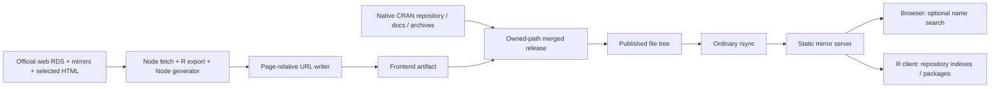

# CRAN Redesign — Mirror Compatibility & Deployment Audit

Date: 2026-10-29. Verified chain: **build → static files → merged publication → local rsync → Nginx → browser/R**.

**Conclusion: frontend portability to root and subdirectory deployments is confirmed after small URL fixes. Distribution through ordinary rsync is technically possible without Node.js/R on mirrors. Full readiness for the official network has not been demonstrated.** Agreed rules are needed for file ownership, publication, canonical/short URLs, directory listings, and recovery from partial updates. Ordinary rsync does not make a release atomic. A direct `dist --delete` overlay destroys resources absent from `dist`; this was reproduced only on a disposable copy.

Key evidence: [browser/HTTP/rsync results](audits/mirrors/2026-10-29/results.json), [complete link audit](audits/mirrors/2026-10-29/link-audit.json), [sizes and normal update](audits/mirrors/2026-10-29/sync-metrics.json), [reproduction instructions](audits/mirrors/README.md). This is a limited stand with a 30-file official corpus, **not a complete CRAN mirror**.

## 1. Confirmed model of official mirrors

Documented facts:

- The CRAN master is at WU Wien; the `cran.r-project.org::CRAN` rsync module is available. The HOWTO recommends recursive synchronization of the entire tree, `-rptlzv --delete`, preferably over SSH. Frequency: at least twice weekly, preferably every 1–2 days, at most twice daily. [CRAN Mirror HOWTO](https://cran.r-project.org/mirror-howto.html).
- The tree contains symlinks; Windows/partial mirrors sometimes need `-L` instead of `-l`. Correct read permissions are required. [HOWTO](https://cran.r-project.org/mirror-howto.html).
- Servers must recognize index files, treat `.shtml` as HTML, and provide listings under `/src` and `/bin`. SSI for `CRAN_HOST` is optional customization; the HOWTO provides Apache and Nginx examples, including prefix `/R`. It does not describe every actual server. [HOWTO](https://cran.r-project.org/mirror-howto.html).
- Versioned short URLs require optional rewrite rules: current source first, then Archive. [HOWTO](https://cran.r-project.org/mirror-howto.html).
- CRAN recommends external references of the form `https://CRAN.R-project.org/package=PKG`; `&version=VER` refers to source for a specific version. [Official package page on an R Project mirror](https://stat.ethz.ch/CRAN/web/packages/).
- R repositories have their own source/binary paths and `PACKAGES`, `.gz`, `.rds`; this contract is independent of the frontend. [R Installation and Administration, §6.6](https://cran.r-project.org/doc/manuals/r-release/R-admin.html#Setting-up-a-package-repository).

Engineering inference: HTML/CSS/JS can be transferred as files while PDFs, archives, and repository indexes remain in the same published tree. No generator is required on the receiving mirror. This was verified locally, not approved by CRAN.

Not publicly established: the specific private publisher, master locks and update order, filesystem snapshots, individual mirror settings, HTTP caches/CDN, and permission to replace existing pages. A common Nginx, filesystem, or short URL rule set is not assumed.

## 2. Actual implementation and change boundary

Read `ARCHITECTURE.md`, `CRAN_COMPATIBILITY.md`, `CRAN_FUNCTIONAL_PARITY.md`, `CRAN_PROPOSAL.md`, `PERFORMANCE.md`, `deploy/README.md`, and `CRAN_ADOPTION_FEASIBILITY.md`; examined templates, data converter, builder, checker, search, CSS/SVG, and deploy configurations. Earlier reports describe the state before this URL change and do not replace this verification.

Build host: Node.js and R; the core generator has no npm library dependencies. Mirror runtime: static files and an ordinary web server. Search JS is optional. No React, SPA, API/backend, new runtime packages, or alias files were added. No new full CRAN acquisition, public load tests, or Lighthouse/k6 campaign was run: these would not answer the routing questions identified here.

**Fixes:**

1. [src/static-urls.mjs](src/static-urls.mjs) and the writer in [scripts/build.mjs](scripts/build.mjs): internal `href/src/action` URLs become relative to the output file. The legacy catalog's static meta refresh is also handled. One artifact supports every tested prefix; no `<base>` is used; local `#anchors` are preserved.
2. [public/search.js](public/search.js): JSON resolves through `new URL('package-search.json', import.meta.url)`, results through `../web/packages/…` relative to the module. Name-only search, ranking, and `[Package, Title]` are unchanged.
3. `buildSite({mirrorResources:true})` / `CRAN_MIRROR_RESOURCES=1`: explicit mode for a complete mirrored tree. Ordinary CRAN `src`, `bin`, `doc`, `web/packages`, `web/checks`, and `web/views` links become relative. **This does not download the files.** Standalone frontend builds retain central resource URLs by default; otherwise downloads from incomplete `dist` would return 404.
4. Provenance links “Official CRAN page”/“Documentation and downloads on CRAN”, metadata URLs with `target=_blank`, mirror selection, central monitoring, and distinct external domains retain their destinations. Explicit provenance/mirror links in templates received `rel=external`.
5. Canonical metadata: existing root-oriented canonical paths become absolute central long URLs. This is the candidate's current consistent policy; the final SEO policy requires CRAN agreement. Public long paths are unchanged.
6. The checker compares resolved paths rather than requiring `/…` spelling; `CRAN_CHECK_ROOT` supports isolated artifacts. `npm test` includes three new URL regressions through the existing test entrypoint. Deployment documentation was corrected.

Visual design, fonts, CSS, package metadata fields, reverse dependency semantics, and runtime architecture were unchanged. Production `dist` and the 8080 configuration remain as before: receiving these fixes requires a new approved build/deployment.

## 3. Link class audit

| Class | Baseline | Candidate and verification |
|---|---|---|
| Navigation, logo/favicon, CSS, search module | `/…`, escapes mount prefix | Page-relative; 12 browser contexts, HTTP, and complete link scan |
| Catalog/letters/package/reverse | Root-relative | Same long paths, resolved within the selected mount |
| Local fragment links | `#…` | Preserved; `#imports` navigation checked in browser |
| Search JSON/result links | Fetch and results relative to domain root | Relative to module URL; lazy fetch from same origin/prefix |
| Source, binary, PDF/manual/check/vignette resources | Often absolute master URLs | Mirror mode: local repository/doc paths; standalone: central fallback |
| Official originals, metadata URLs | Intentional external navigation | Explicitly retained; not automatically replaced throughout text |
| CRAN Archive, mac.R-project.org, R Project, submission, external projects | Other origins | Remain external; complete mirroring of those services not assumed |
| Canonical metadata | Relative central-long spelling | Absolute central-long URL; not used for navigation |
| Short `/package=…` | Unsupported by stock static configuration | Separate optional server rule; HTML does not create it |
| Provider `_headers` | Domain-root patterns | Not universal server configuration; prefix hosts must adapt; Nginx ignores it |

CSS has no external fonts, `@import`, or file asset URLs; SVG uses internal gradient fragments. Public templates/asset code contain no development `localhost`/workspace routing. File URLs are not a supported search deployment: ES modules/fetch were tested over HTTP.

Full scan of the current mirror artifact: **33 606 HTML files, 964 670 local reference occurrences, 148 747 external occurrences, 127 909 checked fragment reference occurrences; 0 root-relative URL attributes**. Checked 33 608 distinct generated targets and 5 distinct preserved official targets. This is a local file scan, not a million HTTP requests.

Scan limitations ([link-audit.json](audits/mirrors/2026-10-29/link-audit.json)):

- 76 903 distinct target paths are absent from the limited corpus: mostly package PDFs/sources and other native resources. This is **not** evidence of absence from actual CRAN. Adoption requires a complete authoritative-tree inventory.
- Three manual links `R-lang.html → R-exts.html#Writing-R-documentation` lack the corresponding fragment in the saved converted target, across all three R versions. They already exist in the original archived render; URL portability work does not fix them. This remains a documentation defect in the candidate.
- Five unquoted attributes in macOS tools: four external URLs and `old.html`. The latter remains correctly relative to the same directory; its file is outside the corpus. The regex writer is not a general HTML parser/sanitizer. Regression review is needed when upstream markup changes.

## 4. Isolated stand and deployment matrix

Native ext4: `/var/tmp/cran-mirrors-20261029`, confirmed in [filesystem.txt](audits/mirrors/2026-10-29/filesystem.txt). Separate PID/log/config, loopback only. Server 8080 and system configuration were not edited.

| Deployment | Baseline port | Candidate port | Baseline | Candidate |
|---|---:|---:|---|---|
| `/` | 8111 | 8101 | Navigation/search work; short URL without rule returns 404 | Checks passed |
| `/CRAN/` | 8112 | 8102 | CSS/JS request `/assets`; search/form fail | Checks passed |
| `/pub/CRAN/` | 8113 | 8103 | Same root-path errors | Checks passed |

Port 8104 serves a separate disposable rsync destination. The stand uses 30 saved official files from the adoption audit: package/repository indexes, genuine source/archive/ZIP/PDF files, checks, Task Views, a vignette, and some original HTML. Sources/hashes: [original inventory](audits/adoption/2026-10-29/inventory.json), [additional resources](audits/adoption/2026-10-29/resource-bodies.json). No new bulk requests to mirrors were made.

The full candidate is an **offline pass of the current writer over a previously generated complete official-data snapshot**, with current search.js and provenance annotations from current templates. It is not a new complete fetch/build; the [adapter](audits/mirrors/archived-html.mjs) explicitly identifies the archived render difference. Actual generation by current `buildSite` was tested separately on A/B fixtures and offline regressions. The full standalone variant passed the standard checker: 33 606 HTML files, 25 585 package pages, 7 949 reverse pages; all reverse counts/lists/anchors/local/external categories checked. The checker does not validate the complete native CRAN inventory.

During preparation, Windows tar was read before packaging finished and returned EOF. Auxiliary packaging was stopped; preparation switched to reading saved generated files on native ext4. This was a corrected stand preparation error, not a CRAN test finding. The final [native verifier](audits/mirrors/verify-native.mjs) confirmed all generated hashes and corpus preservation.

## 5. Browser, HTTP, search, and R clients

The [automated probe](audits/mirrors/probe.mjs) blocks external browser network access. Result: **36 recorded checks**, including:

- 12 browser contexts: 3 mounts × 390/1440 px × JS off/on. Actual catalog → letter G → ggplot2 → reverse imports → package navigation; 26 letters; >5 000 Imports entries; CSS, canonical, PDF URL resolution, no horizontal overflow or unexpected HTTP errors.
- 48 search query checks: home and catalog × 3 mounts × 2 widths × `termr`, `ggplot2`, `plot`, `GGPLOT2`. Name ordering matches the existing ranking function. JSON is not requested before first submit; one index request per document across multiple queries; navigation to a new document may reload it. `[Package, Title]` is unchanged.
- JS off: catalog/letters/packages/reverse remain accessible; JSON unnecessary. The no-JS form displays the catalog rather than simulating server-side search.
- 21 HTTP resource/route checks per mount: home, three platforms, catalog/letter/package/reverse, documentation, CSS/JS/SVG, actual repository index, source/archive, ZIP, package PDF, checks, Task Views, vignette. Installer paths resolve within the mirror prefix, but large R installers were not downloaded into the corpus and their local availability is not claimed.
- 3 short resolver cases and 4 actual 404s per mount. Unknown package/path/version does not receive homepage/SPA fallback. The static 404 body is a stand configuration fixture, not a new production page. Other servers may supply their own error page.
- Actual R 4.5.2 read source `PACKAGES.rds` at all three mounts: **25 600 records, termr 1.0.1**. [root](audits/mirrors/2026-10-29/r-client-root.txt), [prefix](audits/mirrors/2026-10-29/r-client-prefix.txt), [nested](audits/mirrors/2026-10-29/r-client-nested.txt). This is an unfiltered repository index, not 25 585 current web package records. No packages were installed; legacy PACKAGES/.gz fallback workflows were not tested. Windows R reported startup locale warnings; all three checks passed.

Screenshots: [root mobile/no-JS](audits/mirrors/2026-10-29/mirror-8101-nojs.png), [subdirectory](audits/mirrors/2026-10-29/mirror-8102-nojs.png), [nested](audits/mirrors/2026-10-29/mirror-8103-nojs.png). The nested screenshot was visually inspected. Offline tests: **24/24** — [log](audits/mirrors/2026-10-29/node-tests.txt).

## 6. Canonical and short URLs

`/web/packages/ggplot2/index.html` is an ordinary file. Root deployment preserves the long URL; a subdirectory yields `PREFIX/web/packages/ggplot2/index.html` without a new package route format. The server must correctly serve directory indexes and append a slash to directory URLs.

The generator does not create `/package=ggplot2`. All three baseline static servers without rules return 404. The [local configuration](audits/mirrors/2026-10-29/nginx.conf) separately adds a 303 resolver preserving the mount prefix and checking target existence. Versioned URLs return current source or archive; unknown targets return 404. This is a test model, not a reconstruction of CRAN's private configuration. The HOWTO also gives an Apache example; universal Nginx is not assumed.

No 25 585 alias files were created. Even single-block aliases would add about 100 MiB at 4 KiB allocation, 25 585 files/inodes, and stale-alias cleanup, without solving arbitrary version aliases. Server-side routing remains a separate contract, optional for ordinary HTML navigation. CRAN's canonical external short reference and HTML `rel=canonical` need agreement: metadata currently uses the central long URL, whereas CRAN recommends the short reference URL. Three local examples cannot establish the state of all official mirrors.

## 7. Reproducible rsync update

Synthetic [A/B fixtures](audits/mirrors/2026-10-29/fixtures.json) are explicitly not official package releases. A contains five package records, including RetiredAuditPackage; B removes it, adds AddedAuditPackage, and changes the ggplot2 title and reverse Imports. Search/catalog/letter pages and reverse pages use the ordinary generator. Each release **first** receives a copy of the entire 30-file official corpus, **then** the owned overlay. The destination is confined to the dedicated stand.

Download paths for synthetic package releases are not asserted to exist. R clients and actual package downloads were checked on the full official-data overlay; native PACKAGES is not generated from synthetic A/B records. Fixture checks do not demonstrate that these fictional versions can be installed.

For the repeatable positive test, the [fixture stamp script](audits/mirrors/stamp-fixtures.mjs) assigns identical timestamps to identical content and distinct timestamps to changed files. This is controlled test input, **not an implemented production builder optimization**.

Normal A→B: `rsync -rptlzvi --delete --stats`, native ext4, local directories. [Full stdout](audits/mirrors/2026-10-29/normal-b.txt), [hashes/metrics](audits/mirrors/2026-10-29/sync-metrics.json):

| Measurement | Result |
|---|---:|
| Files in each merged fixture release | 49 |
| Regular files added | 2: new package and letter A |
| Regular files deleted | 2: old package and letter R |
| Existing files with changed content | 5 |
| Regular files transferred | 7 |
| Transferred content size / literal data | 19 260 B |
| Rsync bytes sent / received | 5 726 / 303 B |
| Local A→B wall time | About 56 ms |

Rsync also counts the created/deleted package directory: 3 entries each, not 3 regular files. `-z` explains the difference between protocol bytes sent and literal bytes. This is a local measurement, not a network forecast for CRAN; latency, transport, compression, and full tree size differ.

After B, all file hashes were checked against release B, new package returned 200, removed package 404, and catalog/search/reverse were updated. The 13 protected payload/doc files were checked over HTTP with SHA-256 after update and rollback. The full overlay separately preserved all 21 nonowned original files; all 30 originals remained unchanged. In particular, archives, binary repositories/indexes, PDFs, checks, Task Views, and the vignette were not replaced by HTML.

Negative tests:

- [quick-check-mismatch.json](audits/mirrors/2026-10-29/quick-check-mismatch.json): in the initial accelerated A/B run, changed `web/packages/index.html` had the same size and a timestamp within the same second; the standard quick check skipped it, and full hash validation detected it. The [rsync documentation](https://download.samba.org/pub/rsync/rsync.1) describes size/mtime quick checks. The publisher must provide distinguishable timestamps for changed content or separate checksum/manifest validation; `--checksum` over the entire tree costs a read of every file.
- [unsafe-overlay-negative.txt](audits/mirrors/2026-10-29/unsafe-overlay-negative.txt): raw overlay → disposable copy using `--delete` removed repository RDS, source archive, binary ZIP, and package PDF. This did not affect the original or merged releases. `--delete` is appropriate only against a complete authoritative namespace or strictly validated owned-path manifest.

## 8. Consistency, interruption, and rollback

The [interrupted test](audits/mirrors/2026-10-29/interrupted.txt) copies one actual B HTML file, then rsync exits nonzero on a deliberately unavailable source. HTTP observes the B main page alongside the A reverse page. This is a deterministic partial-publication model, not a simulated WAN break at a particular byte offset. Repeating full rsync B repairs the state; rollback A then restores the removed package and deletes the added package.

| Scenario | Finding / required action |
|---|---|
| HTML before CSS/JS | Asset names are unversioned; an old cache may serve an old asset. In this change, CSS is unchanged and the search module is compatible with the old index. Future incompatible releases need a retention/versioning plan. |
| Main before reverse | Mixed snapshots observed; counts alone do not prove list membership freshness. Retry or roll back the full merged release. |
| Search before catalog | Separate files with no shared HTTP transaction. Preserve the index format, validate the snapshot before publication, and check integrity after rsync. |
| Removed package | After completed `--delete`, old page returns 404; old content may remain during sync/in caches. Archive/tombstone policy requires CRAN agreement. |
| Interrupted rsync | Check exit status; do not announce success. Retry from an immutable source and validate the manifest. |
| Tab open during update | May use cached HTML and later a new index; an atomic pointer alone does not provide session consistency. |

The existing builder performs two directory renames and deletes the successful backup: this is not uninterrupted live-tree publication with retained rollback. An atomic pointer on the master does not guarantee atomic rsync on a mirror.

Minimum compatible operational path: finish and validate a merged source snapshot; publish a consistent namespace; retain ordinary mirror rsync; monitor exit status and keep a repeatable repair/rollback artifact. Operators must explicitly accept the remaining temporary mixtures. `--delay-updates` and deferred deletion shorten the window but do not turn the full file set and browser cache into a transaction; the [rsync manual](https://download.samba.org/pub/rsync/rsync.1) describes a faster final replacement phase, not global atomicity.

A stronger optional path: the receiver synchronizes into staging, validates, then switches a local pointer; suitable filesystems may save space through hardlinks/reflinks. This adds mirror operator duties, not a runtime application. Minimal intervention and mandatory complete atomicity on all mirrors cannot both be promised. CRAN must decide whether the cost and approach are acceptable.

Stand rollback: restore A through the same local rsync, then verify hashes, package/catalog/search/reverse, and protected payloads. Production rollback must affect frontend ownership only or an agreed complete snapshot; native repository payloads cannot be rolled back independently of current `PACKAGES`.

## 9. Size, inodes, and update cost

[Full manifest](audits/mirrors/2026-10-29/full-manifest.json) and native measurements:

| Metric | Value |
|---|---:|
| Generated files, including `_headers` | 33 611 |
| HTML | 33 606 |
| Package / nonempty reverse pages | 25 585 / 7 949 |
| Generated logical bytes in mirror mode | 213 223 208 B (~203.3 MiB) |
| CSS / JS | 30 298 / 3 267 B |
| Single search JSON | 1 675 826 B |
| Merged limited tree, including stand 404 fixture | 33 633 regular files |
| Its subdirectories / entries including root directory | 25 620 / 59 254 |
| Native ext4 `du` merged limited tree | 395 390 976 B (~377.1 MiB) |

Logical bytes are below the previous 218 540 640 B because URL spelling changed; this is not a measured user latency improvement. This is total overlay size, not established net growth over full CRAN: 9 corpus files are intentionally overwritten (including logo and HTML index pages); other actual collisions remain unknown pending full inventory.

The reverse feature adds 7 949 files beyond main pages; the earlier detailed measurement found 37 963 786 B of reverse HTML plus 16 171 556 B of summaries. [PERFORMANCE.md](PERFORMANCE.md), [reverse audit](audits/reverse-dependencies/README.md). Relative URLs change sizes; these earlier figures are a historical feature baseline, not a newly measured feature delta.

The adoption audit already measured a **real small full-snapshot update**: only 6 generated files differed in content, but the builder rewrote 33 606 HTML files and JSON with new mtimes. Local `rsync -a --delete --stats` transferred 33 607 regular files, 218 504 196 B literal data, and sent 221 584 797 B; about 12.88 s on native ext4. [stdout](audits/adoption/2026-10-29/rsync-update.txt). This was a different test without `-z`; it neither contradicts the 19 KB controlled fixture update nor predicts remote delta wire bytes.

Therefore, **inexpensive small production updates are not yet ensured**. A publisher must retain byte-identical files' mtimes and ownership manifests, or use another agreed incremental publication scheme. That proposal was not implemented as part of the small URL fix. Estimate: a separate publisher pass compares N files/about 213 MB of output, reads the previous release, and stores a manifest; exact CPU/IO cost requires build-host measurement. This comparison should not become a mandatory checksum scan of hundreds of gigabytes of CRAN on every mirror.

Current+rollback+staging frontend needs about 640 MB logical storage, plus directory/slack overhead and inputs; three complete copies of the limited merged tree here require about 1.19 GB allocation. Full native CRAN cannot be copied per frontend release without a separate storage plan. The HOWTO's historical 410 GB refers to 2024 and is not used as the current size.

Earlier measured full build time: 238.36 s, including acquisition/export 194.86 s and generation/publication 43.50 s; sampled peak summed working set 588 MiB, process tree CPU ≥206.58 CPU-s. [Adoption measurements](audits/adoption/2026-10-29/build-resources.json), [build result](audits/adoption/2026-10-29/build-result.json). No new network full-build benchmark was run in this audit. Node/R are builder-only; mirrors do not run them. Apache/other OS deployment and network rsync throughput were not measured.

## 10. Risks and required decisions

| Risk | Status / required action |
|---|---|
| Native resource loss through `dist --delete` | Demonstrated in negative control. Complete merged authoritative tree/ownership publisher required. |
| Overlay hides directory listings | Existing generated index.html in `/src/contrib` and some `/bin` routes changes discovery. Payload bytes survive, but listing presentation is a real functional change; CRAN must approve routes. |
| Namespace collisions | 9 collisions in the 30-file corpus; `/assets`, logo, and HTML ownership need full inventory. |
| Prefix navigation/search | Fixed and checked on three Nginx mounts. Compatibility with every server/configuration unproven. |
| Private rewrite/SEO policy | External agreement needed on short routes and canonical; stock configs still lack short resolver. |
| Partial rsync/cache mixtures | Reproduced; completion/repair/rollback and acceptable window require agreement. |
| Excessive mtime updates | Full generator rewrites unchanged HTML; incremental publisher remains a proposal. |
| Incomplete functional inventory | Not all Task Views/vignettes/binaries/native docs appear in corpus/frontend. Complete mirror inventory required. |
| Converted HTML/security | New URL writer does not resolve previously identified sanitizer gaps. Official publication requires security review, CSP/trust policy, and confirmation of frontend distribution rights. See adoption report. |
| Maintenance/ownership | Responsibility for generator, Node/toolchain updates, upstream markup regressions, stale releases, and incidents is not agreed. |

Changes are limited to URL portability and its checks. Larger items — incremental ownership publisher, hashed assets/retention, and mandatory receiver-side staging — require separate proposals, full-tree cost assessment, and operator approval.

## 11. Objective acceptance criteria

- [x] Root/subdirectory/nested frontend navigation and assets checked; JS unnecessary for primary navigation.
- [x] Name-only search, existing ordering/format, correct origin/prefix, and lazy index loading checked.
- [x] Long package URLs preserved; short routing identified as a separate requirement.
- [x] A/B add/update/delete/reverse/search, interrupted state, repair, and rollback checked locally.
- [x] Limited native resources preserved; raw-overlay deletion risk disclosed.
- [x] No Node.js/R required on mirrors; production 8080 unchanged.
- [ ] Complete authoritative-tree inventory and directory index collisions approved by CRAN.
- [ ] All substantial native downloads/docs/anchors available; three retained manual fragment defects resolved.
- [ ] Canonical/robots/indexing policy, actual servers' short rules, and prefix cache rules agreed.
- [ ] Acceptable rsync consistency, cache compatibility, retention, and recovery SLA approved.
- [ ] Small production update cost reduced/accepted; full network mirror rehearsal performed with operator.
- [ ] Apache/Windows/partial mirrors and symlink/permissions cases checked within agreed scope. The earlier adoption stand confirmed one relative symlink through local rsync; insufficient for the whole network.
- [ ] Security, reproducible toolchain/artifact provenance, license/ownership, and long-term support accepted by responsible parties.

## 12. Questions for CRAN and recommended path

1. Which HTML/index/logo/assets paths may be overwritten, and which listings must remain native?
2. Where does the builder obtain a consistent web metadata + native resource snapshot, and how does it integrate with the existing publisher?
3. Which mirror prefixes, server families, symlink/permissions/partial-tree policies, and short URL guarantees are supported?
4. Should HTML canonical use the official short reference URL or central long URL? How are mirrors/experimental frontend indexed, and who configures robots/headers?
5. Are temporarily mixed releases acceptable with existing rsync? If not, who implements receiver-side staging and pays storage costs?
6. Who approves asset/cache retention, incremental mtimes, ownership deletion manifests, rollback, and incident handling?
7. Who maintains the builder/toolchain, responds to upstream HTML changes, and owns functional/security acceptance?

Recommended path: **separate official/experimental frontend → limited approved HTML overlay → full merged-tree publication rehearsal with operator → expansion after acceptance criteria**. Testing confirmed that ordinary files can distribute the frontend without installing applications on mirrors. It also showed that minimal mirror duties depend on publisher-side work and explicit agreement on temporary consistency; three local Nginx mounts do not establish compatibility with the entire CRAN network.

No commit/push or public infrastructure creation occurred. The separate Nginx stand was stopped after testing; configurations, data, and reproducible checks were retained.
